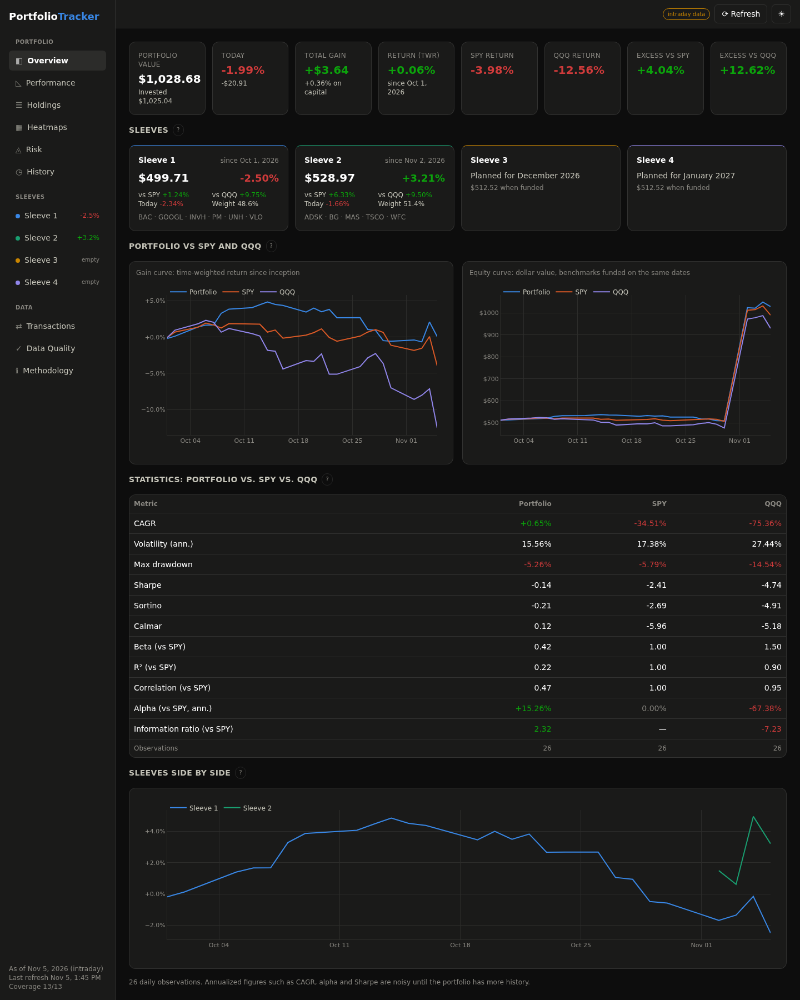
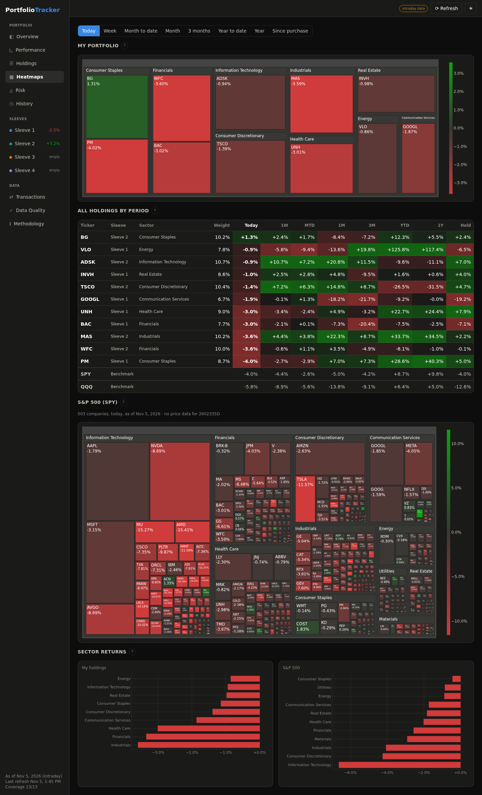
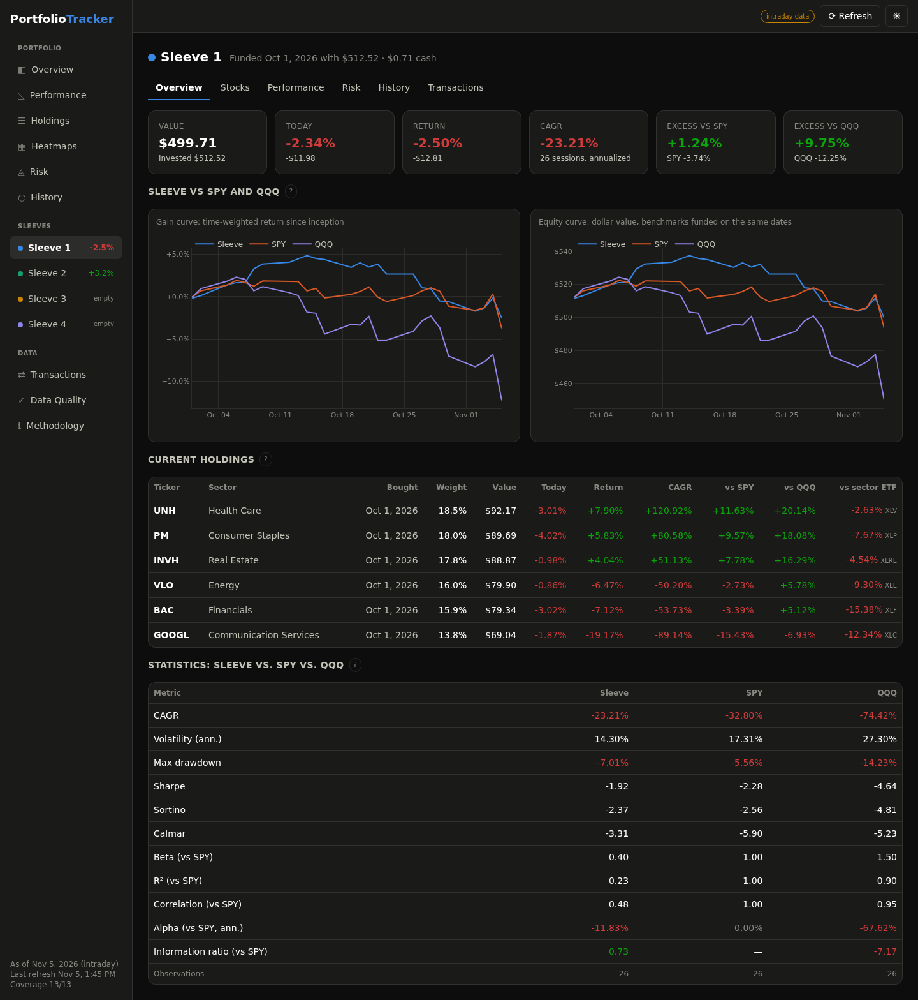
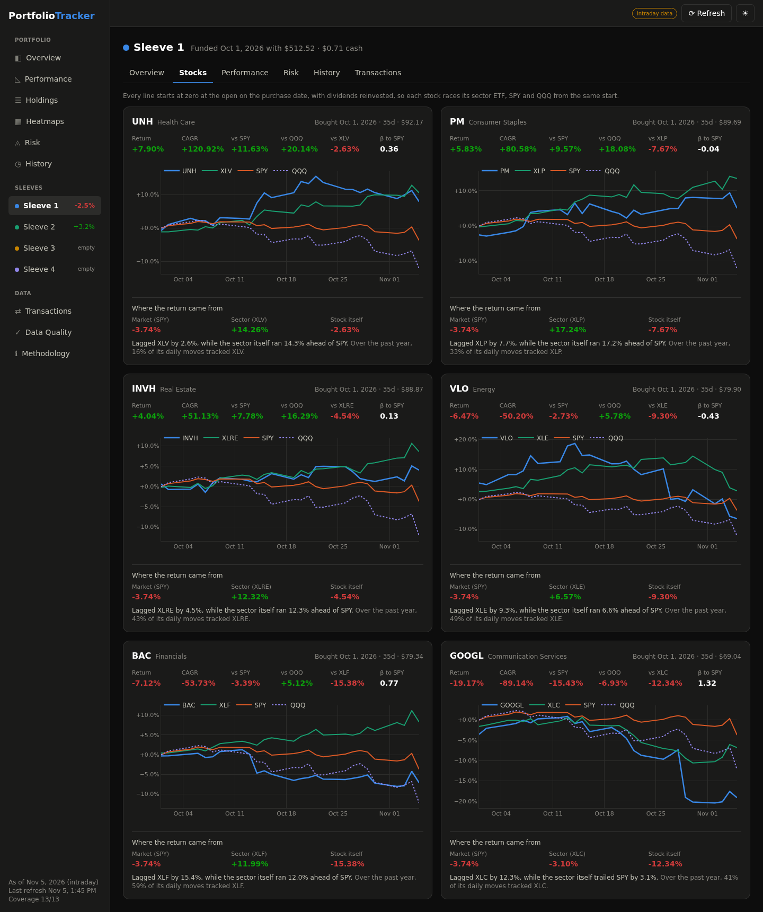
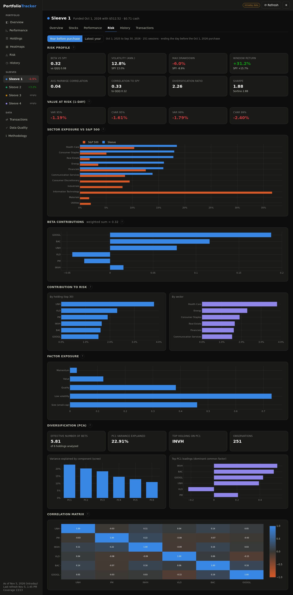
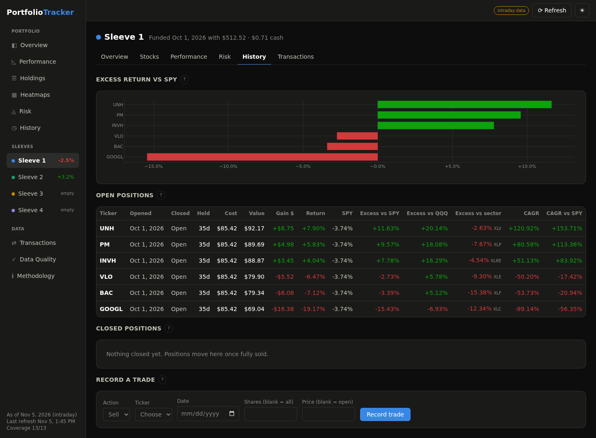

# Portfolio Tracker

A personal dashboard for a portfolio run as **four equally funded sleeves** of 4–6 stocks. Each
sleeve is bought in equal dollars at a single day's open, and the sleeves roll up into one
portfolio measured against SPY and QQQ, with institutional-grade performance and risk analytics
refreshed automatically every trading day.

It ingests an append-only transaction ledger per sleeve (buys, sells, dividends, splits, deposits,
withdrawals), reconstructs daily positions and cash from it, pulls in daily market data, and turns
that history into time-weighted returns, benchmark comparisons, factor exposure and correlation/PCA
diversification analysis.

## Portfolio

The whole book: value, today's move, return against SPY and QQQ, a card for each sleeve, equity and
gain curves, and a full statistics table (CAGR, volatility, max drawdown, Sharpe, Sortino, Calmar,
beta, R², correlation, alpha, information ratio) for the portfolio, SPY and QQQ. New sleeves join
as they're funded, and the benchmarks receive the same money on the same dates.

**Performance** adds rolling beta, volatility and correlation, drawdowns, period returns, and daily
and monthly return calendars. **Holdings** lists every position with sector allocation and return
contribution.

## Heatmaps

One period control (today, week, month to date, month, 3 months, year to date, year, since purchase)
drives a treemap of your holdings, a table of every holding across every period, and a map of all
~500 S&P 500 companies sized by SPY's published weights.

## Sleeves

Each sleeve opens to its own tabs.

**Overview:** the sleeve against SPY and QQQ, current holdings, and its statistics.

**Stocks:** every holding against its sector ETF, SPY and QQQ from the purchase-day open, with its
return split into market, sector and stock itself, to show whether a stock is really working or
just riding its sector.

**Risk:** the sleeve over the year before purchase, or the latest year: beta, volatility, drawdown,
VaR, correlation matrix, PCA (including PC1), factor exposure, risk contribution, and sector
exposure against the S&P 500.

**History:** every open and closed position with its excess return over SPY, QQQ and its sector ETF
across exactly its holding window, plus a form for recording trades.

**Performance** and **Transactions** give the same deep views as the portfolio, plus a Monte Carlo
test of the sleeve's picks against random S&P 500 baskets. An empty sleeve shows a form for funding
it instead.

## Data Quality

A transparency page: sync status per symbol, stale/failed price fetches, and refresh-run history, so
it's always clear how fresh and complete the underlying data is.

---

## How it works, in short

- **Ledger-first**: nothing is ever edited in place, daily positions, cash, and returns are all
  reconstructed from an append-only transaction log.
- **Time-weighted returns (TWR)** for performance that isn't distorted by when cash moved in or
  out, geometrically linked daily; **XIRR** for money-weighted, dollar-actual returns.
- **Benchmarks** (SPY, QQQ) receive the identical external cash flows on the identical dates, so
  "vs. benchmark" comparisons are apples-to-apples, including as each sleeve is funded.
- **Beta, alpha, VaR/CVaR, factor exposure, and PCA-based diversification** are computed directly
  from daily return history, never approximated from vendor betas or static weights.
- Prices refresh automatically on a daily schedule; intraday data is marked provisional until
  the next end-of-day pass confirms it.

Full methodology, the exact formulas, edge-case handling, and invariants, is documented on the
in-app **Methodology** page and in [PROJECT_SPEC.md](PROJECT_SPEC.md).

## Stack

FastAPI + SQLAlchemy + pandas backend · React + TypeScript + Vite + Tailwind + Plotly frontend ·
Financial Modeling Prep (FMP) or keyless Yahoo Finance market data · SQLite storage · APScheduler for end-of-day refresh ·
Docker Compose for deployment.

For setup and local development instructions, see [SETUP.md](SETUP.md).
